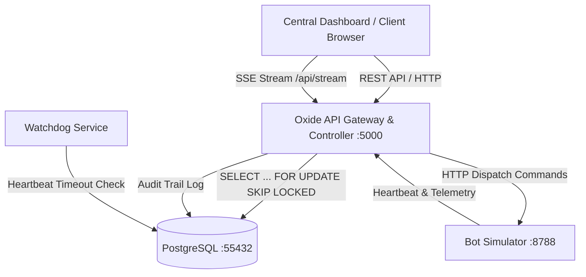

# Oxide Bot Monitor – Centralized Bot Monitoring & Order Tracking Service

> **Technical Assessment: Back End Developer**  
> ระบบศูนย์กลางควบคุมบอทอัตโนมัติ (Centralized Bot Monitoring & Control Center) และระบบติดตามออเดอร์ (Order Tracking Service)  
> พัฒนาโดย: **Sabooky91989**  
> Repository: `https://github.com/Sabooky91989/oxide-bot-monitor`  
> Live Dashboard & API: `http://localhost:5000`  
> Bot Simulator: `http://localhost:8788`  
> PostgreSQL: `localhost:55432`  

---

## 1. ภาพรวมสถาปัตยกรรมระบบ (System Architecture)

ระบบประกอบด้วย 4 เลเยอร์หลัก ออกแบบตามมาตรฐาน High-Throughput & Real-Time Monitoring:



### สแตกเทคโนโลยีที่ใช้ (Tech Stack)
- **Backend**: Node.js 22, Express, TypeScript, Zod, pg (PostgreSQL Client Pool), Winston Logger
- **Database**: PostgreSQL 16 (พอร์ต 55432 แยกอิสระจากโปรเจกต์อื่น)
- **Real-Time Streaming**: Server-Sent Events (SSE) `/api/stream` สำหรับส่งการเปลี่ยนแปลงสถานะบอท, คำสั่ง และออเดอร์ทันที
- **Containerization**: Docker & Docker Compose (`docker compose up`)
- **Testing**: Jest, Supertest (11 Unit & Integration Tests ผ่าน 100%)

---

## 2. การจัดการเคสปัญหา 5 ข้อ (5 Problem Cases Solution)

### Case 1: การป้องกัน Concurrency แย่งงานกันระหว่างบอทหลายเครื่อง (Race Conditions)
- **ปัญหา**: เมื่อมีบอทหลายตัว (Kaotam Bot 01-05) พร้อมทำงานในเวลาเดียวกัน อาจเกิดปัญหาดึงออเดอร์เดียวกันไปทำซ้ำ (Double Dispatch)
- **การแก้ไข**: ใช้ **`SELECT ... FOR UPDATE SKIP LOCKED`** ภายใน Database Transaction
  ```sql
  SELECT id, external_order_id, amount, currency
  FROM orders
  WHERE status = 'pending'
  ORDER BY created_at ASC
  LIMIT 1
  FOR UPDATE SKIP LOCKED;
  ```
  กลไกนี้ทำให้ Transaction ที่หยิบแถวไปแล้วล็อกแถวนั้นไว้ ส่วน Worker อื่นจะข้ามแถวนั้นทันทีโดยไม่ต้องรอ Lock Timeout ทำให้ไม่มีการแจกงานซ้ำซ้อนและได้ Throughput สูงสุด

### Case 2: กลไก Global Kill-Switch & Safety Controls
- **ปัญหา**: เมื่อเกิดข้อผิดพลาดฉุกเฉินในระบบเติมเงิน ต้องหยุดกระบวนการจ่ายงานทันทีทุกเครื่อง
- **การแก้ไข**: 
  - มีสวิตช์ `KillSwitchService` ที่ควบคุมแบบ Centralized
  - เมื่อสั่ง `POST /api/kill-switch { "enable": false }`:
    - API การแจกงาน `/api/orders/dispatch` จะปฏิเสธทันทีด้วย HTTP `403 Forbidden` (`KILL_SWITCH_ACTIVE`)
    - ระบบบรอดแคสต์สถานะผ่าน SSE ไปยังทุก Dashboard Client แบบ Real-time
    - บันทึกการเปิด/ปิดสวิตช์ลงในตาราง `audit_logs` ทุกครั้ง

### Case 3: การตรวจจับและกู้คืน Heartbeat Timeout (Zombie Bot Recovery)
- **ปัญหา**: เครื่อง Node/Notebook ที่รันบอทอาจเครื่องดับ ไฟตก หรือเน็ตหลุดกะทันหัน
- **การแก้ไข**: 
  - Watchdog ทำงานทุก 10 วินาที ตรวจสอบฟิลด์ `last_heartbeat` ในตาราง `oxide_bot_agents`
  - หาก `last_heartbeat < NOW() - INTERVAL '30 seconds'` ระบบจะปรับสถานะเครื่องเป็น `'offline'` อัตโนมัติ
  - หากบอทนั้นกำลังถือออเดอร์ค้างอยู่ (`status = 'processing'`) จะมีการ Flag และบันทึก Audit Log เพื่อนำออเดอร์กลับเข้าคิวหรือแจ้งเตือนแอดมิน

### Case 4: Idempotency ในการรับคำสั่งและการจัดการออเดอร์
- **ปัญหา**: เครือข่ายมี Latency สูงทำให้ Client หรือระบบภายนอก Retry คำสั่งซ้ำ
- **การแก้ไข**:
  - `orders.external_order_id` ใช้ Unique Constraint ร่วมกับ `ON CONFLICT (external_order_id) DO UPDATE`
  - ตาราง `oxide_bot_commands` บันทึก Command ID แบบเฉพาะเจาะจง พร้อมสถานะ (`queued`, `running`, `success`, `failed`)
  - ออเดอร์ที่ถูกประมวลผลแล้วจะไม่สามารถย้อนกลับมาถูกหยิบซ้ำได้

### Case 5: การจัดการ Code Deployment & Rollback (Versioning & Integrity)
- **ปัญหา**: การ Deploy โค้ดใหม่ไปยังบอททุกเครื่องพร้อมกัน อาจเกิดข้อผิดพลาดระหว่างเครื่องออนไลน์/ออฟไลน์
- **การแก้ไข**:
  - รองรับทั้ง **Deploy รวมทุกเครื่อง (Deploy All)** และ **Deploy แยกรายเครื่อง (Targeted Deploy)**
  - มีระบบ Auto-package versioning (`oxide-YYYY-MM-DDTHH-mm-ss.zip`) ตรวจสอบความถูกต้องและบันทึกประวัติผู้ Deploy (`audit_logs`)

---

## 3. ขั้นตอนการติดตั้งและรันระบบ (Setup & Installation)

### รันผ่าน Docker Compose (แนะนำ สะดวกที่สุดในคำสั่งเดียว)

```bash
cd oxide-monitor-candidate-pack

# รันระบบทั้งหมด (PostgreSQL, Simulator, และ API/Dashboard)
docker compose up -d --build
```

- **Dashboard UI**: เปิดเบราว์เซอร์ไปที่ `http://localhost:5000`
- **Bot Simulator**: `http://localhost:8788`
- **PostgreSQL**: `localhost:55432` (Username: `oxide`, Password: `oxide_dev`, DB: `oxide_monitor`)

### การรัน Seed ข้อมูล (หากต้องการรีเซ็ตฐานข้อมูล)
```bash
docker exec -i oxide-monitor-candidate-pack-postgres-1 psql -U oxide -d oxide_monitor < db/schema.sql
docker exec -i oxide-monitor-candidate-pack-postgres-1 psql -U oxide -d oxide_monitor < db/seed.sql
```

---

## 4. การทดสอบระบบ (Automated Tests & API Testing)

### 4.1 รัน Automated Test Suite (Jest)
```bash
docker compose run --rm app npm test
```
**ผลการทดสอบ: 11 Passed / 11 Total (100% Pass)**
- Healthcheck & API basic test
- Bot agent listing & status sync
- Overview summary metrics calculation
- Bot command execution (start, stop, restart) & simulator integration
- Global Kill-switch activation & dispatch prevention (HTTP 403)
- Code packaging & deployment to all/single bot
- Order dispatch concurrency protection (SKIP LOCKED)
- Audit logs trail generation

### 4.2 ทดสอบผ่าน REST Client
- **ไฟล์ .http**: สามารถเปิดไฟล์ `oxide-monitor.http` ใน VS Code / REST Client เพื่อทดสอบทุก Endpoint
- **Postman Collection**: นำเข้าไฟล์ `postman_collection.json` เพื่อทดสอบ API ทั้งหมด

---

## 5. สรุปรายการ API Endpoints

| Method | Endpoint | คำอธิบาย |
|--------|----------|----------|
| `GET` | `/health` | ตรวจสอบสถานะการทำงานของเซิร์ฟเวอร์ |
| `GET` | `/api/bots` | ดึงรายชื่อบอททั้งหมด พร้อมสถานะและ Metrics ล่าสุด |
| `GET` | `/api/bots/:id` | ดึงรายละเอียดบอทรายเครื่อง พร้อมประวัติคำสั่งล่าสุด |
| `POST` | `/api/bots/:id/commands` | ส่งคำสั่งควบคุมบอท (`start`, `stop`, `restart`, `status`) |
| `GET` | `/api/summary` | ตัวเลขสรุปภาพรวม (Online, Active, Standby, In Progress) |
| `GET` | `/api/kill-switch` | ตรวจสอบสถานะ Kill Switch ปัจจุบัน |
| `POST` | `/api/kill-switch` | เปิด/ปิด Kill Switch ทั้งระบบ (`enable: true/false`) |
| `GET` | `/api/packages` | ดูรายการแพ็กเกจโค้ดทั้งหมด และเวอร์ชันล่าสุด |
| `POST` | `/api/packages/pack` | แพ็กโค้ดเวอร์ชันใหม่ |
| `POST` | `/api/packages/deploy` | สั่ง Deploy แพ็กเกจไปยังบอททุกเครื่อง หรือเครื่องที่ระบุ |
| `GET` | `/api/orders` | ดูรายการออเดอร์ทั้งหมดในระบบ |
| `POST` | `/api/orders` | สร้างออเดอร์ใหม่เข้าสู่สถานะ `pending` |
| `POST` | `/api/orders/dispatch` | กระจายงานออเดอร์ให้บอท (Atomic Concurrency-safe) |
| `POST` | `/api/orders/:id/complete`| ปรับสถานะออเดอร์เป็น `completed` เมื่อเติมเงินสำเร็จ |
| `GET` | `/api/audit-logs` | ดึงประวัติ Audit Trail ทุกการสั่งการในระบบ |
| `GET` | `/api/stream` | Server-Sent Events (SSE) Real-time Data Stream |

---

## 6. โครงสร้างไฟล์ในโปรเจกต์

```text
oxide-monitor-candidate-pack/
├── db/
│   ├── schema.sql              # Database Schema (ตารางบอท, คำสั่ง, ออเดอร์, audit)
│   └── seed.sql                # Seed Data ตั้งต้น 5 เครื่องบอทตาม Mockup
├── simulator/
│   └── server.js               # Bot Simulator ให้บริการพอร์ต 8788
├── src/
│   ├── config/env.ts           # การจัดการ Environment Configuration
│   ├── database/db.ts          # PostgreSQL Connection Pool & Query Wrapper
│   ├── modules/
│   │   ├── audit/              # Audit Logging Service
│   │   ├── bots/               # Bot Agent Management & Command Dispatch
│   │   ├── orders/             # Order Lifecycle & Concurrency-safe Dispatcher
│   │   ├── realtime/           # Server-Sent Events (SSE) Broadcaster
│   │   └── system/             # Kill-switch & Package Deployment Management
│   ├── public/
│   │   └── index.html          # High-Fidelity Centralized Dashboard UI (HTML/CSS/JS)
│   ├── app.ts                  # Express App, Routes & Global Error Handler
│   └── server.ts               # Server Entrypoint, Simulator Sync & Heartbeat Watchdog
├── tests/
│   └── oxide.test.ts           # Automated Test Suite (11 Test Cases)
├── docker-compose.yml          # Multi-Container Compose Setup (Postgres, Simulator, App)
├── Dockerfile                  # Production-ready Container Build
├── package.json
├── tsconfig.json
├── jest.config.js
├── postman_collection.json     # Postman Collection
└── oxide-monitor.http          # .http Request Collection
```
